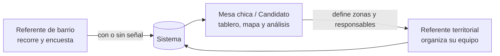

# Geointeligencia Territorial

**Control territorial y tablero estratégico para campañas municipales.**

Geointeligencia Territorial convierte el trabajo de los referentes en el barrio en información para decidir: qué le preocupa a cada barrio, dónde falta recorrer, quién está trabajando en este momento y en qué zonas está la elección. Todo en un mapa, en tiempo real, y con los datos protegidos para que no se filtren.

🔗 **Demo en vivo:** https://jjcampis.github.io/geointeligencia/

---

## ¿Qué problema resuelve?

En una campaña territorial la información suele estar dispersa en planillas, grupos de WhatsApp y cuadernos. Así cuesta responder preguntas básicas:

- ¿Qué barrios ya recorrimos y cuáles no?
- ¿Cuál es el reclamo principal de cada zona?
- ¿Dónde están los indecisos?
- ¿Los referentes están realmente en la calle?
- ¿Quién tiene acceso a los datos de los vecinos?

Geointeligencia Territorial ordena todo eso en un solo sistema, con un mapa como centro.

---

## Cómo funciona

1. **La mesa chica divide la ciudad en zonas** sobre el mapa y asigna un referente territorial responsable a cada una.
2. **El referente territorial suma a su equipo** de referentes de barrio y les envía el acceso por WhatsApp con un toque.
3. **El referente de barrio inicia su recorrida** desde el celular y carga encuestas puerta a puerta, aunque no tenga señal.
4. **La mesa chica y el candidato ven todo en tiempo real:** cobertura, demandas por barrio, intención de voto, quién está en la calle y sugerencias de estrategia.

---

## Tres roles, tres niveles de acceso

Cada persona ve **solamente lo que necesita para su tarea**. Así la información estratégica queda en manos de la mesa chica.

### 🏘️ Referente de barrio
Pensado para el celular, simple y rápido.
- Ve **sólo su zona asignada**, dividida en cuadrantes, con lo que falta recorrer ordenado por cercanía.
- Carga la **encuesta** en menos de un minuto: problemas del barrio, opinión sobre la gestión actual, conocimiento del candidato, intención de voto y contacto (con consentimiento del vecino).
- **Funciona sin internet:** las encuestas quedan guardadas en el celular y se envían solas cuando vuelve la señal.
- Inicia y finaliza su **recorrida**, compartiendo su ubicación sólo mientras está trabajando.
- No puede ver las respuestas que ya envió.

### 🗺️ Referente territorial
Organiza el trabajo en las zonas que tiene a cargo.
- Ve **únicamente las zonas que le asignó la mesa chica**, con su avance y los puntos ya relevados.
- **Da de alta y de baja** a sus referentes de barrio.
- Sigue **en vivo** a su equipo: quién está en línea, por dónde recorre y cuántas encuestas hizo cada uno.
- **No ve el contenido de las respuestas**, sólo cantidades. Un referente que cambia de bando no se lleva la base de datos.

### 🎯 Mesa chica / Candidato
La visión completa para tomar decisiones.
- **Tablero** con encuestas, cobertura, zonas sin relevar, referentes activos y vecinos que aceptaron ser contactados.
- **Mapa estratégico** que se puede ver por cobertura, por problema principal de cada barrio o por intención de voto.
- **Zonas en disputa:** ranking de barrios por indecisos, apoyo, conocimiento del candidato y valoración de la gestión actual.
- **Todas las respuestas**, con quién entrevistó, dónde y cuándo; filtros por zona, referente, problema e intención; exportación a planilla.
- **Seguimiento en vivo** de todos los referentes, con su recorrido del día, kilómetros caminados y alertas de quien está fuera de su zona.
- **Análisis con inteligencia artificial:** prioridades por barrio, oportunidades, alertas y mensajes sugeridos a partir de lo relevado.
- **Gestión de zonas:** se crean arrastrando una forma (hexágono o cuadrado) sobre el mapa o dibujándolas a mano, y se ajustan moviendo sus vértices.

---

## Lo que lo hace distinto

| | |
|---|---|
| 📶 **Funciona sin señal** | Pensado para barrios con mala conectividad: la app se instala en el celular y trabaja offline. |
| 🔒 **Datos compartimentados** | Cada rol ve sólo lo suyo. El contenido de las encuestas queda en la mesa chica. |
| 📍 **Control real del territorio** | Cada encuesta queda georreferenciada y cada referente muestra su recorrida, lo que permite detectar encuestas cargadas desde la casa. |
| 🗺️ **El mapa como centro** | Cobertura, demandas, intención de voto y equipo en la calle, todo sobre el mapa de la ciudad. |
| 🤖 **Análisis con IA** | Convierte cientos de encuestas en prioridades concretas por barrio. |
| 📱 **Sin instalar nada raro** | Se usa desde el navegador del celular o la computadora y se puede agregar a la pantalla de inicio como una app. |

---

## Privacidad

- La encuesta pide el **consentimiento informado** del vecino antes de guardar sus datos.
- El contacto por WhatsApp sólo se registra si el vecino lo acepta.
- La ubicación del referente se comparte **sólo durante la recorrida**, y él decide cuándo empieza y cuándo termina.
- Los accesos se pueden dar de baja en el momento.

---

## Probá la demo

👉 **https://jjcampis.github.io/geointeligencia/**

Contraseña para todos los usuarios: `demo`

| Rol | Usuario |
|---|---|
| Mesa chica / Candidato | `candidato` |
| Referente territorial | `terri.centro`, `terri.oeste`, `terri.sur` |
| Referente de barrio | `barrio.cabello`, `barrio.centro`, `barrio.itaembe` |

> La demo usa datos ficticios de Posadas (Misiones) y simula la actividad de los referentes en la calle. Cada navegador tiene su propia copia de los datos: para ver el circuito completo, cargá una encuesta como referente de barrio, cerrá sesión y entrá como `candidato`.

---

## Contacto

**JJ-Robótica** · Posadas, Misiones · [jjrobotica.com.ar](https://jjrobotica.com.ar)